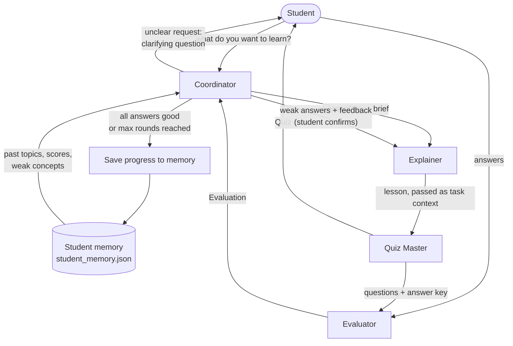

# Leo - Multi-Agent AI Tutor

Leo is a command-line study assistant built with [CrewAI](https://www.crewai.com/) and Google Gemini.
You tell it what you want to learn and a small team of agents takes it from there: one plans the
session, one teaches, one writes a quiz, and one marks your answers. Anything you get wrong is sent
back for re-teaching before you're quizzed on it again.

## The agents

| Agent | Role | Output |
|---|---|---|
| **Coordinator** | Reads the student's request, checks it's clear and teachable, picks the topic, level and learning goals, and briefs the Explainer. Asks a clarifying question when a request is vague. Also runs the session: decides who goes next, retries stalled agents and decides when to re-teach. | `LessonPlan` (structured) |
| **Explainer** | Teaches the topic from the Coordinator's brief. In the feedback loop it re-teaches only the concepts the student got wrong, using a different explanation. | Markdown lesson |
| **Quiz Master** | Writes practice questions from the lesson it is handed (multiple choice + short answer), each tied to one concept. | `Quiz` (structured) |
| **Evaluator** | Marks each answer against the Quiz Master's answer key (correct / partial / incorrect), with feedback per question. | `Evaluation` (structured) |

Each agent has its own role, goal and backstory in [`leo/config/agents.yaml`](leo/config/agents.yaml),
and each step has its own prompt template in [`leo/config/tasks.yaml`](leo/config/tasks.yaml). Values
like `{topic}`, `{level}` and `{student_history}` are filled in by CrewAI at run time.

## Architecture



### Orchestration pattern

Leo uses the **sequential** pattern, driven by the Coordinator:

1. **Planning crew** - Coordinator turns the request into a `LessonPlan` (or asks for clarification, up to 3 times).
2. **Lesson crew** (`Process.sequential`) - Explainer task -> Quiz Master task. The quiz task gets the lesson
   through CrewAI's `context`, so the questions are written from what was actually taught.
3. **Student answers** the quiz in the terminal.
4. **Evaluation crew** - the Evaluator gets the Quiz Master's questions and answer key together with the
   student's answers and returns a structured `Evaluation`.
5. **Feedback loop (bonus)** - any answer scoring under 70% goes back to the Explainer together with what the
   student wrote and the Evaluator's feedback. The **re-teach crew** (Explainer -> Quiz Master) re-explains only
   those concepts and writes fresh questions on them, then it's back to step 3. Up to 2 re-teach rounds.
6. **Human in the loop (bonus)** - before each re-teach the student is asked whether to send the weak answers
   back to the Explainer or stop there.

The control loop lives in [`leo/session.py`](leo/session.py); the crews are built in [`leo/crew.py`](leo/crew.py).

### Memory

- **Within a session**, every handoff carries the previous agent's work forward: the lesson goes to the Quiz
  Master as task context, the quiz + answer key go to the Evaluator, and the Evaluator's feedback goes back to
  the Explainer.
- **Across sessions**, `student_memory.json` remembers each student by name: topics studied, level, final
  score and the concepts they were still weak on. The Coordinator gets this history when planning, so a
  returning student is welcomed back and the lesson is pitched (and focused) accordingly.

### Handling problems

- **Unclear request** ("teach me stuff", "all of science") - the Coordinator asks one clarifying question instead
  of guessing, and gives up politely after 3 tries.
- **Agent stalls** - every agent has a time limit (`LEO_STEP_TIMEOUT`). If a step errors, times out, hits the
  API rate limit or returns output that doesn't fit the expected structure (e.g. the Evaluator skipped a
  question), the Coordinator says so, waits and retries; the final attempt goes to a backup model. If it still
  fails the session ends with a clear message instead of a stack trace.
- **Rate limits** - crews are capped at `LEO_MAX_RPM` requests a minute to stay inside the Gemini free tier.

## How to run

Requires Python 3.10-3.13 and a [Gemini API key](https://aistudio.google.com/apikey).

```bash
python -m venv .venv
# Windows: .venv\Scripts\activate    macOS/Linux: source .venv/bin/activate
pip install -r requirements.txt
cp .env.example .env               # then put your key in .env
python main.py
```

The defaults are Gemini "flash-lite" models on purpose: on the free tier the bigger flash models only allow
about 20 requests a day, and one Leo session makes 10-15 requests.

Optional settings (in `.env`):

| Variable | Default | |
|---|---|---|
| `LEO_MODEL` | `gemini/gemini-3.5-flash-lite` | main model |
| `LEO_BACKUP_MODEL` | `gemini/gemini-3.1-flash-lite` | used for the last retry; set empty to disable |
| `LEO_MAX_RPM` | `4` | max LLM requests per minute per crew |
| `LEO_STEP_TIMEOUT` | `120` | seconds an agent gets per task |
| `LEO_MEMORY_FILE` | `student_memory.json` | where student memory is stored |

## Example session

```
Hi! What's your name?: Sam
Coordinator: Nice to meet you, Sam.
What would you like to learn today?: teach me stuff
Coordinator: What specific subject or topic would you like to focus on today?
You: how photosynthesis works
Coordinator: Plan: Photosynthesis at beginner level.
  Coordinator --lesson plan--> Explainer
  done: Explainer finished 'explain topic'
  done: Quiz Master finished 'create quiz'
  ... the lesson ...
  Explainer --lesson--> Quiz Master
Quiz Master: Your turn - answer each question ...
  Quiz Master --questions, answer key and your answers--> Evaluator
  ... Evaluator's marking table ...
Coordinator: The Evaluator flagged 2 weak answer(s): ...
Send these back to the Explainer for another go? [y/n] (y):
  Evaluator --weak answers + feedback--> Explainer
```

## Project layout

```
main.py                 entry point, reads settings from .env
leo/config/agents.yaml  role / goal / backstory per agent
leo/config/tasks.yaml   prompt template per task
leo/crew.py             builds the agents, tasks and sequential crews
leo/session.py          the Coordinator's control loop: handoffs, feedback loop, retries
leo/models.py           Pydantic schemas for structured output (LessonPlan, Quiz, Evaluation)
leo/memory.py           per-student long-term memory
leo/ui.py               terminal output - shows which agent is working and every handoff
```

# Demo video

[https://drive.google.com/file/d/133qpwEY2KrHI5SNOSpxu6cxIooejlMgc/view?usp=sharing](https://drive.google.com/file/d/133qpwEY2KrHI5SNOSpxu6cxIooejlMgc/view?usp=sharing)